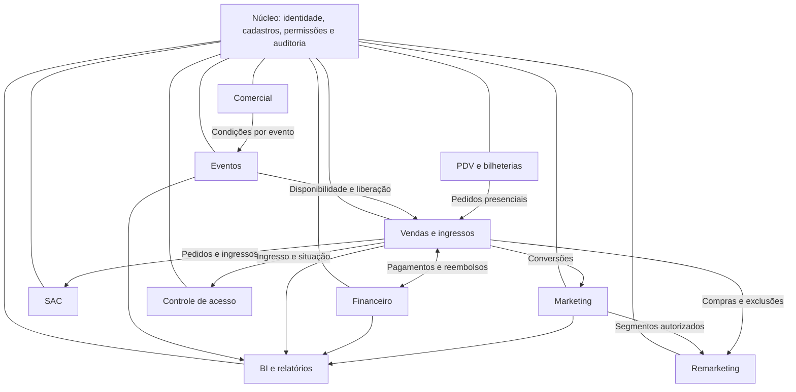

# ERP DiskIngressos — Arquitetura modular

Versão: 1.0 • Data: 05/11/2026 • Status: proposta para engenharia

## 1. Objetivo e decisão central

Organizar o ERP DiskIngressos em módulos com autonomia funcional, conectados por contratos de integração. Comercial, Financeiro, SAC, Marketing e Remarketing **não constituem etapas sequenciais**. Cada módulo pode operar conforme suas permissões e os dados de que sua operação precisa.

Autonomia funcional não elimina dependências de negócio: uma venda exige um evento liberado; um repasse exige saldo elegível; uma emissão exige confirmação válida da compra. Essas condições não obrigam um departamento a concluir seu trabalho inteiro para outro funcionar.

Este documento consolida o fluxo fornecido. Recomendações técnicas são propostas; questões sem resposta permanecem pendentes. Não representa implementação ou integração já existente.

## 2. Mapa de módulos

| Módulo | Responsabilidade | Principais dados sob sua gestão |
| --- | --- | --- |
| Núcleo | Identidade, permissões, cadastros compartilhados e auditoria | Usuários, perfis, produtores, compradores, referências comuns |
| Eventos | Cadastro, sessões, setores, lotes, capacidade, análise e publicação | Eventos, sessões, inventário e aprovações |
| Vendas e ingressos | Checkout, pedidos, confirmação de compra, emissão e entrega | Pedidos, itens, ingressos e histórico de emissão |
| Comercial | Carteira, negociações, contratos e taxas específicas por evento | Negociações, versões de condições comerciais e contratos |
| Financeiro | Contas, recebíveis, gateways, conciliação, estornos, antecipações e repasses | Transações, lançamentos, liquidações e demonstrativos |
| SAC | Atendimento por telefone, chat e e-mail; chamados, filas e SLA | Chamados, interações, prazos e base de conhecimento |
| Marketing | Campanhas, UTMs, investimentos e atribuição de conversões | Campanhas, configurações e métricas |
| Remarketing | Segmentação e recuperação de vendas com uso autorizado de dados | Públicos, regras, exclusões e execuções |
| PDV e bilheterias | Operação presencial, operadores e fechamento de caixa | Caixas, movimentos e referências aos pedidos |
| Controle de acesso | Validação de ingressos e registro de entrada | Validações, dispositivos e ocorrências |
| BI e relatórios | Indicadores consolidados e consultas executivas | Projeções analíticas derivadas dos módulos de origem |

Cada módulo deverá possuir menu, dashboard, configurações, permissões e relatórios próprios. Cadastros compartilhados terão uma fonte oficial: o Comercial poderá cadastrar uma produtora por meio do serviço do núcleo, sem manter uma cópia concorrente do cadastro.

## 3. Organização técnica proposta

Adotar inicialmente um **monólito modular**: uma aplicação organizada em limites explícitos por domínio. A autonomia dos departamentos não exige serviços implantados separadamente.

- Cada módulo controla suas regras e operações de escrita.
- Outros módulos consultam ou solicitam alterações por interfaces definidas; não escrevem diretamente em tabelas alheias.
- Um banco compartilhado pode ser utilizado, com organização lógica por módulo e integridade referencial.
- Eventos internos comunicam fatos já confirmados. APIs atendem consultas e comandos que precisam de resposta imediata.
- BI recebe projeções; seus relatórios não alteram dados operacionais.
- A separação futura em serviços deverá responder a necessidades comprovadas de escala, operação ou isolamento.



As setas representam troca de informação, não uma sequência obrigatória de execução entre departamentos.

## 4. Fluxos de negócio

### 4.1 Produtor, evento e publicação

1. Cadastrar a produtora e seus responsáveis no núcleo.
2. Registrar o evento e seus ingressos em Eventos.
3. Registrar no Comercial a negociação específica desse evento.
4. Submeter o evento às validações e aprovações aplicáveis.
5. Publicar o evento no site e habilitar os canais autorizados.
6. Abrir vendas quando as condições de liberação forem cumpridas.

Cadastro da produtora: razão social, nome fantasia, CNPJ, inscrições quando aplicáveis, endereço, contatos, responsável legal, representantes, dados bancários, documentos e situação cadastral. Acesso a documentos e dados bancários deve ser restrito por função.

Cadastro do evento: produtor, nome, descrição, local, datas, classificação etária, capacidade, sessões quando aplicáveis, setores, tipos de ingresso, preços, lotes, períodos de venda, materiais e política de cancelamento.

Modelar aprovação, publicação e vendas como dimensões separadas. Por exemplo, um evento aprovado pode estar publicado com vendas ainda fechadas. Estados propostos:

| Dimensão | Estados iniciais sugeridos |
| --- | --- |
| Aprovação | Rascunho, em análise, pendente de correção, aprovado, rejeitado |
| Publicação | Não publicado, publicado, retirado |
| Vendas | Não abertas, abertas, suspensas, encerradas |
| Realização | Previsto, realizado, adiado, cancelado |

Mudanças de data, cancelamento e alterações relevantes após aprovação precisam de regras próprias de revisão, comunicação e auditoria.

### 4.2 Venda e emissão

1. Consultar disponibilidade e condições vigentes do evento.
2. Identificar o comprador ou concluir seu cadastro durante o checkout, conforme decisão pendente.
3. Reservar o inventário por prazo definido e calcular preços e taxas no servidor.
4. Criar pedido com cópia dos valores e da versão comercial aplicada.
5. Solicitar pagamento ao provedor habilitado para o canal.
6. Confirmar a compra com evidência validada do pagamento ou da forma de recebimento presencial.
7. Consumir o inventário reservado e emitir os ingressos uma única vez.
8. Enviar os ingressos ao e-mail cadastrado, registrando resultado e permitindo reenvio auditado.

Comprador e participante são entidades distintas quando não forem a mesma pessoa. O cadastro de pessoa física contempla nome, CPF, e-mail, telefone e demais campos cuja necessidade seja definida para a operação.

O ingresso terá exatamente oito caracteres numéricos, preservando zeros iniciais se forem permitidos. Esse número é uma identificação de apresentação; a validação de acesso deve usar uma credencial segura independente. O escopo da unicidade ainda precisa ser decidido.

### 4.3 Operação paralela dos departamentos

- Comercial negocia eventos e acompanha contratos independentemente dos chamados de SAC.
- Financeiro concilia pagamentos e calcula saldos e repasses conforme regras financeiras.
- SAC atende clientes e solicita operações autorizadas aos serviços responsáveis por pedidos, ingressos e reembolsos.
- Marketing configura campanhas e acompanha vendas atribuídas sem aguardar fechamento financeiro.
- Remarketing atualiza públicos, respeita exclusões após compra e verifica autorização antes de cada execução.

## 5. Regras comerciais e financeiras

1. A taxa administrativa pertence ao evento. Não aplicar automaticamente a condição de outro evento do mesmo produtor.
2. A taxa pode ser percentual ou fixa. Base de cálculo, incidência por ingresso ou pedido, pagador e arredondamento precisam ser definidos explicitamente.
3. Condições comerciais devem possuir versão, vigência, autor e aprovação aplicável.
4. O pedido conserva a condição usada na compra. Alterações posteriores não recalculam vendas anteriores automaticamente.
5. Separar valor do ingresso, taxa administrativa, processamento, descontos, reembolsos e valores devidos ao produtor.
6. Não tratar valores recebidos em nome do produtor automaticamente como receita própria da DiskIngressos.
7. Repasses dependem de saldo elegível, liquidações, ajustes, reservas e aprovações definidas.
8. Estornos, reembolsos e chargebacks possuem registros e efeitos próprios; não apagar o histórico da venda.
9. Spread, Rebate e Advanced permanecem como modalidades a especificar. Não atribuir fórmulas nem presumir que Advanced significa antecipação sem confirmação operacional.

O Financeiro deverá contemplar contas a pagar e receber, bancos, fluxo de caixa, centros de custos, plano de contas, lançamentos, recebíveis, gateways, MDR, tarifas, conciliação, liquidação, repasses, antecipações e auditoria. Split será condicionado ao modelo operacional e ao suporte do provedor escolhido.

## 6. Contratos de integração

Os nomes abaixo são propostas internas, não APIs externas já disponíveis.

| Origem → destino | Contrato ou fato | Resultado esperado |
| --- | --- | --- |
| Comercial → Eventos/Vendas | `CondicaoComercialAprovada` | Disponibilizar versão válida para o evento |
| Eventos → Vendas/PDV | `VendasDoEventoLiberadas` | Permitir pedidos nos canais habilitados |
| Vendas → Financeiro | `PedidoCriado` | Registrar solicitação e referência financeira |
| Financeiro → Vendas | `PagamentoConfirmado` | Autorizar confirmação e emissão idempotente |
| Vendas → SAC/Acesso | `IngressoEmitido` | Disponibilizar referências e situação do ingresso |
| Financeiro → Vendas/Acesso | `ReembolsoConfirmado` | Atualizar pedido e impedir uso conforme política aprovada |
| Vendas → Marketing/Remarketing | `CompraConfirmada` | Registrar conversão e atualizar exclusões |
| Núcleo → Marketing/Remarketing | `PreferenciaDeComunicacaoAlterada` | Atualizar elegibilidade e supressões |
| Acesso → Eventos/BI | `EntradaRegistrada` | Atualizar presença e indicadores |

Todo evento deve conter identificador único, tipo, versão do contrato, instante, referência da entidade e correlação da operação. Transportar apenas os dados necessários; informações sensíveis não devem circular indiscriminadamente.

Implementar publicação confiável após confirmação da transação, por exemplo com outbox transacional. Consumidores devem tolerar duplicidade, falha temporária e entrega fora de ordem. Prever retentativas, fila de falhas e reprocessamento auditado.

Interfaces iniciais sugeridas: cadastro de produtores; submissão e aprovação de eventos; versionamento de condições comerciais; criação de pedidos; recebimento de notificações do gateway; consulta e reenvio de ingressos; abertura de chamados; validação de acesso. Definir rotas e formatos detalhados na especificação de cada módulo.

## 7. Integridade, acesso e auditoria

- Validar permissões no servidor por ação e escopo: departamento, produtor e evento.
- Restringir produtores aos dados e eventos autorizados.
- Registrar autor, instante, motivo e alterações relevantes em preços, taxas, aprovações, pagamentos e acessos administrativos.
- Garantir estoque consistente em compras simultâneas entre site e PDV.
- Validar autenticidade e referência de notificações do gateway; não confirmar pagamento apenas pelo retorno do navegador.
- Usar idempotência para criação de pedidos, confirmação de pagamentos, emissão, reembolso e repasse.
- Impedir entradas duplicadas em validações concorrentes. Operação offline de acesso e PDV exige especificação própria antes de ser habilitada.
- Manter regras de retenção, acesso a dados e preferências de comunicação documentadas; os detalhes legais exigem validação específica.
- Proteger credenciais de integrações e evitar dados de cartão em logs ou cadastros locais.

## 8. SAC, marketing e indicadores

No SAC, configurar catálogo de serviços, filas, responsáveis, prioridade, primeira resposta, solução, calendário, pausas e escalonamento de SLA. Definir processos de incidentes, solicitações, problemas, mudanças e conhecimento inspirados em ITIL, sem presumir certificação ou conformidade já existente.

Marketing deve prever GA4, Google Ads, Meta Ads/Pixel, Spotify Ads, UTMs e Tag Manager. Cada integração depende de especificação, credenciais, capacidades disponíveis e validação técnica. O texto fornecido não comprova integrações existentes.

Configurações de marketing podem existir nos níveis DiskIngressos, produtor e evento, com regras explícitas de precedência e autorização. Essa herança não se aplica automaticamente às taxas comerciais.

Definir janela e modelo de atribuição, origem da receita considerada e tratamento de reembolsos antes de calcular CPA e ROAS. Separar métricas operacionais de valores financeiros conciliados.

Remarketing deve suportar visitantes, início de checkout, abandono, pagamento pendente e compradores; segmentação por evento e produtor; supressões e mensuração. Comunicações de serviço e campanhas promocionais terão finalidades e regras próprias.

## 9. Critérios de aceite essenciais

| Cenário | Resultado verificável |
| --- | --- |
| Dois eventos do mesmo produtor com taxas diferentes | Cada pedido usa apenas a condição de seu evento |
| Evento aprovado com vendas fechadas | Publicação não permite compra antecipadamente |
| Alteração de taxa após uma compra | Pedido anterior conserva valores e versão original |
| Último ingresso disputado entre site e PDV | Apenas uma compra consome a disponibilidade |
| Notificação repetida de pagamento | Não duplica confirmação, lançamento ou ingresso |
| Número de ingresso iniciado por zero | Mantém os oito caracteres em todas as interfaces |
| E-mail de ingresso falha | Compra permanece registrada e entrega admite nova tentativa |
| Reenvio pelo SAC | Ação autorizada e auditada, sem gerar outro ingresso |
| Duas validações simultâneas do mesmo ingresso | Apenas uma entrada é aceita |
| Operador de um produtor consulta outro | Acesso negado pelo servidor |
| Falha do serviço de campanhas | Venda e emissão continuam operando |
| Preferência de marketing revogada | Execuções futuras respeitam a supressão aplicável |
| Reprocessamento de integração | Não duplica o efeito de negócio |

## 10. Decisões pendentes

| Decisão | O que precisa ser definido |
| --- | --- |
| Número do ingresso | Unicidade global ou por evento; zeros iniciais; capacidade e política de esgotamento do espaço numérico |
| Cadastro do comprador | Momento obrigatório e dados exigidos por canal |
| Aprovação | Departamentos envolvidos, aprovação final e situações de reanálise |
| Taxa fixa e percentual | Unidade de cobrança, base, pagador, descontos, arredondamento e devolução |
| Spread, Rebate e Advanced | Significado, fórmula, beneficiário, origem e tratamento de reversões |
| Pagamentos e repasses | Provedores, meios, parcelamento, reservas, prazos e aprovações |
| PDV | Formas de recebimento, fechamento, cancelamento e necessidade de funcionamento offline |
| Controle de acesso | Dispositivos, conectividade, reentrada e contingência |
| Marketing | Contas, propriedade dos dados, atribuição e permissões por produtor |
| SLA | Calendários, prioridades, pausas, metas e escalonamentos |

Nenhuma dessas decisões deve ser considerada aprovada por aparecer como possibilidade neste documento.

## 11. Desdobramento da documentação

Estrutura sugerida para uma futura pasta `docs/`:

```text
00_VISAO_GERAL.md
01_FLUXO_OPERACIONAL.md
02_CADASTRO_PRODUTORES.md
03_GESTAO_EVENTOS.md
04_VENDAS_E_INGRESSOS.md
05_CLIENTES_PESSOA_FISICA.md
06_APROVACAO_E_PUBLICACAO.md
07_PDV_BILHETERIAS.md
08_SAC_ITIL_SLA.md
09_FINANCEIRO.md
10_COMERCIAL.md
11_MARKETING.md
12_REMARKETING.md
13_INTEGRACOES.md
14_SEGURANCA_E_PERMISSOES.md
15_BANCO_DE_DADOS.md
16_REGRAS_DE_NEGOCIO.md
17_CONTROLE_DE_ACESSO.md
18_BI_E_RELATORIOS.md
ARQUITETURA_MODULAR_DISKINGRESSOS.md
```

Cada especificação deverá detalhar requisitos funcionais, entidades, estados, permissões, contratos, falhas e critérios de aceite. A sequência de implementação pode seguir dependências técnicas, sem transformar os departamentos em uma cadeia operacional obrigatória.
