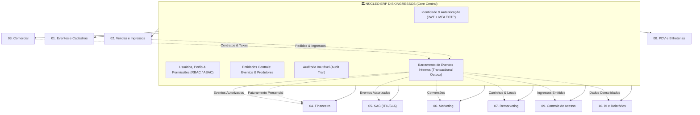
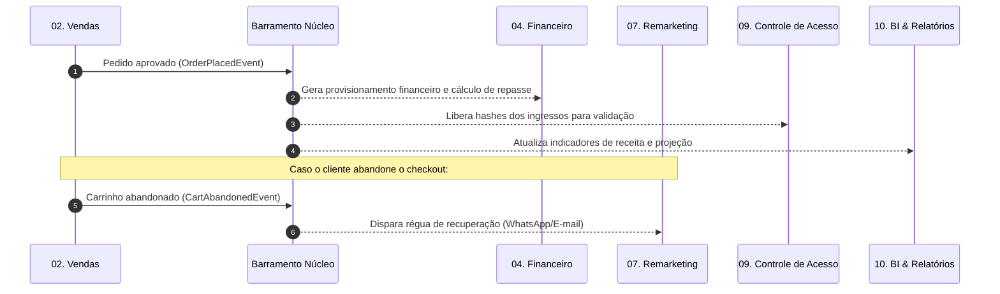

# ARQUITETURA MODULAR DISKINGRESSOS
## Diretriz Arquitetural Oficial: ERP Modular com Autonomia Funcional

---

### 1. Visão Geral e Princípios Fundamentais

O **ERP DiskIngressos** adota o padrão de **Monólito Modular orientado a Domínios (DDD — Domain-Driven Design) com Autonomia Funcional**. 

A premissa central é eliminar dependências sequenciais e acoplamentos rígidos entre os departamentos:
- **Comercial, Financeiro, Marketing, Remarketing e SAC são módulos independentes**.
- Nenhuma operação de um módulo bloqueia ou inviabiliza a execução de outro.
- Todos os módulos orbitam o **Núcleo ERP DiskIngressos**, compartilhando a infraestrutura de identidade, segurança, auditoria e as entidades fundamentais (Produtores e Eventos), sem redundância de dados.

---

### 2. Os 8 Pilares de Autonomia por Módulo

Cada um dos módulos possui:
1. **Menu próprio**: Rota e hierarquia de navegação dedicada na barra lateral e superior.
2. **Dashboard próprio**: Visão analítica exclusiva com KPIs operacionais e estratégicos do setor.
3. **Cadastros e configurações próprias**: Parâmetros, regras de precificação, SLAs, canais e integrações sob controle do gestor da área.
4. **Usuários e permissões específicas**: Papéis RBAC com alçadas e escopos isolados (ex: `COMMERCIAL_MANAGER`, `FINANCIAL_DIRECTOR`, `SAC_ATTENDANT`).
5. **Regras de negócio independentes**: Execução de lógica de domínio sem travas externas.
6. **Relatórios próprios**: Exportação, extratos, demonstrativos e visões operacionais segmentadas.
7. **Banco de dados integrado ao núcleo**: Modelos de dados relacionados às chaves mestras (`tenantId`, `companyId`, `eventId`, `producerId`) sem duplicação de cadastros base.
8. **Comunicação por APIs e eventos internos**: Contratos REST bem definidos e eventos assíncronos via *Transactional Outbox* para sincronização eventual.

---

### 3. NÚCLEO ERP DISKINGRESSOS (Core Central)

O Núcleo é o alicerce unificado de governança e segurança do sistema. Nenhum módulo duplica essas responsabilidades.

| Componente | Responsabilidade |
| :--- | :--- |
| **Identidade & Autenticação** | Login centralizado, tokens JWT HS256, rotação de refresh tokens, MFA TOTP (RFC 6238), recuperação segura de credenciais. |
| **Usuários & Permissões** | Matriz unificada de papéis (RBAC) e políticas baseadas em atributos (ABAC). Cada usuário possui permissões atreladas a módulos específicos. |
| **Eventos & Produtores** | Registro mestre de Produtores (Pessoa Física/Jurídica, CNPJ/CPF, dados bancários) e Eventos (datas, locais, capacidades). |
| **Auditoria Imutável** | Trilha forense completa (`AuditLog`), gravando `userId`, módulo, ação, IP, timestamp e diff de dados (*before/after*). |
| **Transactional Outbox & Event Bus** | Garantia de entrega *at-least-once* para comunicação assíncrona entre módulos sem acoplamento transacional síncrono. |

---

### 4. Catálogo Oficial dos 10 Módulos Autônomos

#### 01 — Eventos e Cadastros
* **Foco**: Gestão completa da grade de atrações, organizadores e arenas.
* **Menu**: `Eventos > Meus Eventos`, `Produtores`, `Locais & Arenas`, `Configurações Gerais`.
* **Dashboard**: Total de eventos ativos, ingressos alocados por setor, calendário de produções.
* **Autonomia**: Cria e homologa eventos sem depender de aprovações comerciais ou financeiras para o cadastro base.

#### 02 — Vendas e Ingressos
* **Foco**: Motor de venda online (E-commerce), carrinho, emissão de e-tickets nominais e loteamento.
* **Menu**: `Vendas > Pedidos`, `Lotes & Ingressos`, `Vouchers & Cortesias`, `Canais Digitais`.
* **Dashboard**: Taxa de conversão do checkout, ingressos emitidos por minuto, ticket médio online.
* **Autonomia**: Processa compras e gera ingressos; publica eventos de venda para processamento financeiro e controle de acesso.

#### 03 — Comercial
* **Foco**: Negociação contratual com produtores, definição de taxas de conveniência, split comercial e metas.
* **Menu**: `Comercial > Contratos`, `Taxas por Evento`, `Propostas`, `Metas & Comissões`.
* **Dashboard**: Volume total contratado (GMV Esperado), margem comercial média, pipeline de captação de eventos.
* **Autonomia**: **Pode negociar e cadastrar contratos e taxas sem qualquer dependência do SAC ou Financeiro.**

#### 04 — Financeiro
* **Foco**: Gestão de tesouraria, split automático de pagamentos, borderô de repasse ao produtor, custódia e conciliação bancária.
* **Menu**: `Financeiro > Contas a Pagar/Receber`, `Gateways & Adquirência`, `Borderôs de Repasse`, `Fluxo de Caixa`, `Conciliação`.
* **Dashboard**: Saldo em custódia, repasses agendados, volume líquido por adquirente, taxas retidas.
* **Autonomia**: **Realiza conciliações bancárias, liquidações e repasses de forma totalmente independente de atendimentos do SAC.**

#### 05 — SAC (Service Desk ITIL & SLA)
* **Foco**: Atendimento ao comprador e ao produtor, central de tickets, mediação de disputas, estornos e cancelamentos.
* **Menu**: `SAC > Fila de Chamados`, `Matriz ITIL & SLA`, `Base de Conhecimento`, `Solicitações de Estorno`.
* **Dashboard**: Tempo Médio de Resposta (MTTA), Tempo Médio de Resolução (MTTR), First Contact Resolution (FCR), índice CSAT.
* **Autonomia**: **Atua e soluciona chamados em tempo real sem interromper operações financeiras ou de venda.**

#### 06 — Marketing
* **Foco**: Gestão de tráfego pago, rastreamento UTM, Server-Side CAPI (Meta/Google), pixels de conversão e ROI por canal.
* **Menu**: `Marketing > Campanhas`, `Construtor de UTMs`, `Pixels & CAPI`, `Cupons Promocionais`, `Atribuição ROAS`.
* **Dashboard**: ROAS por campanha/evento, custo por aquisição (CPA), canais de maior conversão, cliques e impressões.
* **Autonomia**: **Cria campanhas, gera links rastreados e monitora tráfego sem depender de validações do Financeiro.**

#### 07 — Remarketing
* **Foco**: Recuperação de carrinhos abandonados, reativação de compradores inativos, réguas de automação via WhatsApp, E-mail e SMS.
* **Menu**: `Remarketing > Carrinhos Abandonados`, `Segmentação de Públicos`, `Réguas de Disparo`, `Automações`.
* **Dashboard**: Valor de carrinhos recuperados, taxa de reengajamento por canal, conversão de boletos/PIX pendentes.
* **Autonomia**: **Executa campanhas de recuperação consumindo exclusivamente dados de venda autorizados via eventos, sem travar o checkout.**

#### 08 — PDV e Bilheterias
* **Foco**: Venda presencial em pontos fixos e bilheterias no local do evento, operadores de caixa e impressão térmica.
* **Menu**: `PDV > Terminal de Venda`, `Abertura/Fechamento de Caixa`, `Sangrias & Suprimentos`, `Impressoras & Totens`.
* **Dashboard**: Vendas por operador, volume arrecadado por forma de pagamento (Dinheiro/Cartão/PIX), turnos ativos.
* **Autonomia**: Funciona com contingência local; consolida os fechamentos de caixa no núcleo sem bloquear as vendas online.

#### 09 — Controle de Acesso
* **Foco**: Validação de ingressos em tempo real via scanners QR Code, controle de catracas e gestão de lotação.
* **Menu**: `Acesso > Portarias & Catracas`, `Leitores QR Code`, `Sincronização Offline`, `Auditoria de Entradas`.
* **Dashboard**: Lotação da arena em tempo real (% de público presente), fluxo de entrada por hora, tentativas de duplicidade/fraude.
* **Autonomia**: Opera com sincronização assíncrona e modo offline resiliente; não depende de consultas lentas à base financeira no momento da leitura do ingresso.

#### 10 — BI e Relatórios
* **Foco**: Inteligência de dados executiva, demonstrativo de resultado por evento, previsão de demanda e relatórios consolidados.
* **Menu**: `BI > Visão C-Level`, `DRE por Evento`, `Curva de Vendas (Forecast)`, `Relatórios Customizados`.
* **Dashboard**: GMV global, margem de contribuição líquida, projeção de público, ranking de produtores e rentabilidade.
* **Autonomia**: Camada analítica somente-leitura; consultas pesadas e geração de relatórios não impactam as transações operacionais do ERP.

---

### 5. Matriz de Autonomia e Desacoplamento

| Módulo | Ação de Negócio | Não Depende De | Como se Comunica |
| :--- | :--- | :--- | :--- |
| **03. Comercial** | Cadastrar contrato e fixar taxas de conveniência. | SAC, Financeiro, Marketing | Persiste o contrato no Núcleo; emite evento `ContractRateDefined`. |
| **04. Financeiro** | Executar conciliação bancária e fechar borderô. | SAC, Comercial | Lê dados consolidados de vendas; emite `SettlementClosed`. |
| **06. Marketing** | Criar campanhas de tráfego pago e links UTM. | Financeiro, Comercial | Gera tags e parâmetros independentes; escuta eventos de conversão. |
| **05. SAC** | Atender ticket de cancelamento de ingresso. | Financeiro, Vendas | Avalia política de cancelamento; solicita estorno assíncrono via evento `RefundRequested`. |
| **07. Remarketing** | Enviar disparo de WhatsApp para carrinho abandonado. | Vendas, Financeiro | Reage ao evento assíncrono `CartAbandonedEvent`. |
| **09. Acesso** | Validar leitor de QR Code na catraca do evento. | E-commerce, Financeiro | Lê credencial criptografada localmente/cache; emite `AccessGrantedEvent`. |

---

### 6. Contratos e Comunicação por Eventos de Domínio

Toda a interação intermodular ocorre por:
1. **APIs REST Internas**: Chamadas idempotentes com autenticação mútua via contexto do Núcleo (`TenantExecutionContext`).
2. **Eventos de Domínio Assíncronos (Outbox)**: Eventos gravados na transação ACID e distribuídos via Barramento.

---

### 7. Estratégia de Transição da Base de Código Atual

A base de código atual (`E:\DELTA_I`) passará pelas seguintes etapas organizadas:

1. **Documentação e Governança**:
   - `ARQUITETURA_MODULAR_DISKINGRESSOS.md` estabelecido como a referência oficial.
   - Atualização de `docs/02-mapa-de-modulos.md` alinhando os 10 módulos autônomos e o Núcleo.

2. **Contratos Compartilhados (`packages/shared`)**:
   - Adicionar o catálogo oficial `DISKINGRESSOS_MODULES_CATALOG` com os 10 módulos (01 a 10) e os códigos de papéis correspondentes.
   - Manter compatibilidade com serviços existentes durante a transição gradual.

3. **Backend API (`apps/api`)**:
   - Refatorar endpoints em torno dos 10 módulos oficiais autônomos.
   - Garantir rotas dedicadas para Comercial, Financeiro, Marketing, Remarketing e SAC com seus próprios controladores e políticas RBAC.

4. **Frontend Command Center (`apps/web`)**:
   - Navegação lateral e menus isolados para cada um dos 10 módulos.
   - Telas de Dashboard, cadastros específicos e relatórios independentes para cada módulo.
