# 01 — Documento de Arquitetura Geral (DELTA ERP Enterprise)

## 1. Visão Executiva e Diretriz Arquitetural

O **DELTA ERP Enterprise** é uma plataforma de gestão empresarial multiempresa, multiusuário e multimódulo, construída sob o padrão de **Monólito Modular orientado a Domínios (DDD — Domain-Driven Design)**.

### Princípios Inegociáveis
1. **Plataforma Única, Domínios Desacoplados**: Todos os 20 módulos funcionais operam sobre o mesmo **Core ERP**, mas cada módulo possui regras de negócio, serviços, políticas de acesso, contratos (DTOs) e eventos de domínio próprios.
2. **Proibição de Estruturas Paralelas**: Nenhum módulo funcional pode criar tabelas próprias de autenticação, empresas, permissões, notificações ou auditoria. Todos consomem obrigatoriamente o `Core ERP`.
3. **Isolamento Estrito Multiempresa (Tenant & Company Isolation)**: Nenhuma consulta ou mutação de domínio ocorre sem o contexto validado de `tenantId` e `companyId`. Alterar um ID na URL ou payload (`IDOR`) jamais expõe dados de outra empresa.
4. **Rastreabilidade Contábil e Financeira Imutável**: Documentos contabilizados e liquidações financeiras nunca sofrem `DELETE` físico; retificações ocorrem por estorno ou lançamento complementar com trilha de auditoria (`AuditLog`) contendo estado anterior e novo.
5. **Comunicação Orientada a Eventos com Transactional Outbox**: Integrações entre módulos (ex: *Compras → Fiscal → Estoque → Financeiro → Contabilidade*) utilizam eventos de domínio persistidos na mesma transação ACID (`OutboxEvent`) e processados assincronamente via **BullMQ / Redis**.

---

## 2. Diagrama de Camadas e Componentes

```mermaid
flowchart TB
    subgraph Presentation["01 — Presentation Layer (React + TypeScript + Tailwind CSS)"]
        WebInternal["apps/web — Portal Interno\n(Admin, Financeiro, Contábil, Fiscal, RH, Operações)"]
        WebExternal["apps/portal-external — Portal Externo\n(Produtores, Clientes, Fornecedores, Parceiros)"]
        DesignSystem["packages/ui — DELTA Design System\n(Moderno: Fundo Claro, Cores Suaves, Cards Minimalistas)"]
    end

    subgraph APILayer["02 — API Layer (NestJS REST API)"]
        Gateway["API Controllers + Versionamento (/api/v1)"]
        Guards["Guards: JWT + MFA + TenantScope + RBAC/ABAC + FeatureFlag"]
        Interceptors["Interceptors: AuditLog Imutável + Idempotency-Key"]
    end

    subgraph CoreLayer["03 — Core ERP (Motor Central Compartilhado)"]
        Identity["Identity & Auth (JWT + TOTP MFA)"]
        Tenancy["Tenant, Company & Branch Management"]
        Permissions["RBAC + ABAC Policy Engine"]
        Workflow["Workflow & Alçadas Engine"]
        Audit["Audit Engine (Before/After State)"]
        FeatureMgmt["Feature & Module Subscription Manager"]
        Outbox["Transactional Outbox & Event Bus"]
    end

    subgraph DomainLayer["04 — Business Modules (20 Módulos + Extensão Eventos)"]
        Fin["02. Financeiro"]
        Acc["03. Contabilidade"]
        Fis["04. Fiscal"]
        HR["05. RH"]
        CRM["06. Comercial/CRM"]
        Pur["07. Compras"]
        Inv["08. Estoque & 09. Patrimônio"]
        Pay["11. Pagamentos & Gateways"]
        Evt["Extensão: Eventos, Bilheteria & Portal do Produtor"]
        BI["15. BI, Analytics & IA"]
    end

    subgraph InfraLayer["05 — Data & Infrastructure Layer"]
        Postgres[("PostgreSQL 16 + Prisma ORM + RLS")]
        Redis[("Redis 7 + BullMQ Worker Queues")]
        S3[("Storage S3 Compatível (MinIO / AWS S3)")]
    end

    Presentation --> APILayer
    APILayer --> CoreLayer
    APILayer --> DomainLayer
    DomainLayer --> CoreLayer
    CoreLayer --> InfraLayer
    DomainLayer --> InfraLayer
```

---

## 3. Estrutura Padronizada de cada Módulo de Negócio

Todo módulo dentro de `apps/api/src/modules/<module-name>/` segue rigorosamente a mesma anatomia interna:

| Diretório / Arquivo | Responsabilidade |
| :--- | :--- |
| `controllers/` | Endpoints HTTP REST, documentação e extração de contexto (`@CurrentTenant()`, `@CurrentUser()`). |
| `services/` | Casos de uso da aplicação, coordenação transacional e disparo de eventos de domínio. |
| `repositories/` | Acesso a dados via Prisma com filtro obrigatório de `tenantId` e `companyId`. |
| `entities/` | Entidades de domínio ricas, invariantes e cálculos (ex: rateio, impostos, liquidação). |
| `dto/` | Contratos de entrada/saída tipados e validados. |
| `events/` | Definição de eventos publicados ou assinados pelo módulo (ex: `PurchaseOrderApprovedEvent`). |
| `policies/` | Regras ABAC específicas do domínio (ex: alçada de aprovação por centro de custo e valor). |
| `validators/` | Regras de validação semântica e integridade de negócio. |
| `tests/` | Testes unitários e de integração do módulo. |
| `<module>.module.ts` | Registro do módulo no container de Injeção de Dependência do NestJS. |

---

## 4. Estratégia de Evolução (Monólito Modular → Microsserviços Seletivos)

1. **Comunicação Interna por Contratos**: Um módulo **nunca** faz `JOIN` direto ou mutação em tabelas de outro módulo sem passar pela interface de serviço ou por Eventos de Domínio.
2. **Extração sob Demanda**: Caso módulos de altíssima volumetria (como `11. Pagamentos / Webhooks PIX` ou `Extensão de Bilheteria de Eventos`) exijam escalabilidade horizontal independente no futuro, sua pasta de módulo pode ser extraída para um processo próprio mantendo os mesmos contratos em `@delta-erp/shared`.
