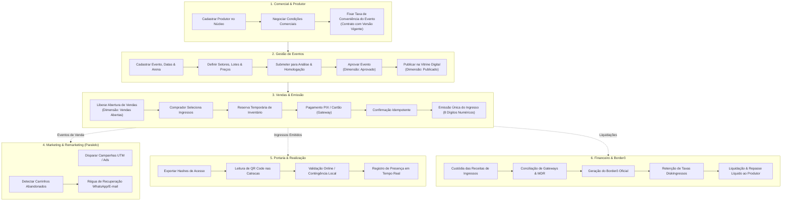

# 01 — Fluxo Operacional Ponta a Ponta (ERP DiskIngressos)

## 1. Visão Geral do Ciclo de Vida do Espetáculo

O fluxo operacional do **ERP DiskIngressos** orquestra o ciclo completo de um evento, desde a captação do organizador até o fechamento financeiro pós-realização, respeitando a **autonomia funcional** de cada departamento:

---

## 2. Detalhamento das Fases

### Fase 1: Cadastro do Produtor e Negociação Comercial
1. **Cadastro Oficial**: O produtor é cadastrado uma única vez no **Núcleo Compartilhado** (Razão Social, CNPJ, dados bancários, responsáveis legais e certidões).
2. **Contrato Comercial por Evento**: O módulo **Comercial** cadastra o contrato definindo a taxa de conveniência acordada (% e/ou fixa por tíquete) para o evento específico.
3. **Isolamento de Segurança**: O Comercial **não tem acesso** a taxas de Spread bancário, Rebate ou Adiantamentos, que permanecem restritos ao Financeiro.

### Fase 2: Configuração e Homologação do Evento
1. **Cadastro do Evento**: O módulo **Eventos** configura local, datas, classificação etária, mapa de setores (Pista, Camarote, VIP), lotes iniciais e capacidade física.
2. **Quatro Dimensões Independentes de Estado**:
   * *Aprovação*: `Rascunho` → `Em análise` → `Aprovado`.
   * *Publicação*: `Não publicado` → `Publicado` (vitrine visível).
   * *Vendas*: `Não abertas` → `Abertas` (compras liberadas).
   * *Realização*: `Previsto` → `Realizado` / `Cancelado`.

### Fase 3: Checkout, Pagamento e Emissão
1. **Seleção e Reserva de Inventário**: Os ingressos selecionados são reservados com lock temporário (tempo de expiração de checkout de 10 a 15 minutos).
2. **Cálculo de Preço**: O cálculo de preços de face, taxas de conveniência e descontos é realizado estritamente no servidor com base na versão comercial congelada do evento.
3. **Pagamento Seguro**: Processado via Gateway integrado (PIX ou Cartão de Crédito).
4. **Emissão Idempotente**:
   * O ingresso recebe um **número de apresentação de exatamente 8 dígitos numéricos** (ex: `00045821`).
   * Gera-se uma **credencial criptográfica independente** (hash SHA-256 assinado) para incorporação ao QR Code da catraca.
   * O ingresso é emitido uma única vez, prevenindo duplicidades em caso de retransmissão de webhook.

### Fase 4: Marketing e Remarketing (Operação Autônoma)
1. **Atribuição**: O módulo de **Marketing** monitora links parametrizados (UTM), medindo conversão e ROAS por campanha sem depender de fechamentos da contabilidade.
2. **Recuperação de Vendas**: O módulo de **Remarketing** escuta eventos assíncronos de abandono de carrinho ou PIX não pago e aciona réguas automatizadas de WhatsApp/E-mail, respeitando preferências de privacidade (LGPD).

### Fase 5: Operação no Dia do Evento (Controle de Acesso)
1. **Sincronização de Credenciais**: A portaria recebe os hashes de validação dos ingressos emitidos.
2. **Validação nas Catracas**: A leitura do QR Code verifica se o ingresso está `ISSUED` e marca como `USED`, registrando timestamp, dispositivo leitor e operador.
3. **Antifraude**: Leituras simultâneas do mesmo código são bloqueadas, aceitando apenas a primeira passagem.

### Fase 6: Fechamento Financeiro e Borderô
1. **Conciliação**: O Financeiro concilia recebimentos líquidos de cartão e PIX com dedução de MDR bancário.
2. **Borderô do Evento**: O extrato final consolida:
   * **Valor Bruto de Face** (passivo em custódia repassado ao produtor).
   * **Taxas de Conveniência** (receita própria da DiskIngressos).
   * **Deduções e Adiantamentos** previamente concedidos pela diretoria financeira.
3. **Liquidação**: Repasse do saldo líquido à conta bancária homologada do produtor.
