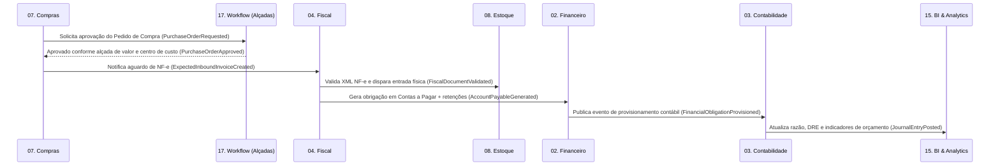

# 02 — Mapa Completo dos 20 Módulos e Extensão de Eventos (DELTA ERP)

## 1. Catálogo Oficial de Módulos (`ModuleCode`)

Todos os módulos são governados pelo `Feature Management` do Core ERP, podendo ser ativados ou desativados por Organização (`Tenant`) e Empresa (`Company`).

| Nº | Código (`ModuleCode`) | Nome do Módulo | Área de Negócio | Fase | Dependências Core / Domínio |
| :-: | :--- | :--- | :--- | :-: | :--- |
| 01 | `DASHBOARD` | Dashboard Executivo e Operacional | Estratégico | 1 | `CORE`, `FINANCIAL` |
| 02 | `FINANCIAL` | Financeiro e Tesouraria | Gestão Financeira | 1 | `CORE` |
| 03 | `ACCOUNTING` | Contabilidade e Controladoria | Gestão Financeira | 2 | `CORE`, `FINANCIAL` |
| 04 | `FISCAL` | Fiscal e Tributário | Gestão Financeira | 2 | `CORE`, `FINANCIAL`, `ACCOUNTING` |
| 05 | `HR` | Recursos Humanos e Folha | Gestão de Pessoas | 3 | `CORE`, `FINANCIAL`, `ACCOUNTING` |
| 06 | `CRM` | Comercial e CRM | Gestão Comercial | 3 | `CORE` |
| 07 | `PURCHASING` | Compras e Suprimentos | Gestão Operacional | 3 | `CORE`, `FINANCIAL`, `WORKFLOW` |
| 08 | `INVENTORY` | Estoque e Materiais | Gestão Operacional | 4 | `CORE`, `PURCHASING`, `FISCAL` |
| 09 | `ASSETS` | Patrimônio e Manutenção | Gestão Operacional | 4 | `CORE`, `ACCOUNTING`, `INVENTORY` |
| 10 | `SALES` | Vendas e Faturamento | Gestão Comercial | 3 | `CORE`, `CRM`, `FINANCIAL`, `FISCAL` |
| 11 | `PAYMENTS` | Pagamentos, Gateways e Adquirência | Gestão Financeira | 2 | `CORE`, `FINANCIAL` |
| 12 | `CONTRACTS` | Gestão de Contratos | Gestão Comercial | 3 | `CORE`, `FINANCIAL`, `DOCUMENTS`, `WORKFLOW` |
| 13 | `SAC` | Atendimento, SAC e Estornos | Relacionamento | 3 | `CORE`, `SALES`, `PAYMENTS` |
| 14 | `MARKETING` | Marketing e Integrações Comerciais | Relacionamento | 4 | `CORE`, `CRM`, `SALES` |
| 15 | `ANALYTICS` | BI, Analytics e Inteligência Artificial | Inteligência | 5 | `CORE`, todos os módulos ativos |
| 16 | `DOCUMENTS` | Gestão de Documentos e Assinaturas | Governança Core | 1 | `CORE` |
| 17 | `WORKFLOW` | Workflow, Processos e Alçadas | Governança Core | 1 | `CORE` |
| 18 | `EXTERNAL_PORTAL` | Portal Externo (Clientes, Fornecedores, Produtores) | Relacionamento | 4 | `CORE`, `FINANCIAL`, `CONTRACTS`, `EVENTS` |
| 19 | `ADMINISTRATION` | Administração, Segurança e Governança | Governança Core | 1 | `CORE` |
| 20 | `INTEGRATIONS` | Hub de APIs, Webhooks e Conectores | Governança Core | 2 | `CORE` |
| EXT | `EVENTS` | Gestão de Eventos, Bilheteria e Repasses | Extensão Vertical | 4 | `CORE`, `FINANCIAL`, `PAYMENTS`, `EXTERNAL_PORTAL` |

---

## 2. Mapa de Integração por Eventos de Domínio

---

## 3. Extensão Especializada: Eventos, Bilheteria e Portal do Produtor (`EVENTS`)

Para isolar regras de negócio específicas do setor de entretenimento e eventos sem poluir a contabilidade padrão:
- **Cadastro de Eventos e Produtores**: Vínculo contratual de taxas de serviço (conveniência, processamento, adquirência) por evento.
- **Lotes, Ingressos e Canais (Online e PDV/Bilheteria)**: Rastreamento de vendas por lote e canal de venda.
- **Split e Conta Corrente do Evento (`ProducerSettlement`)**: Separação clara entre:
  - *Valores em Custódia / Repasse ao Produtor* (Passivo transitório de terceiros)
  - *Receita Própria da Plataforma/Operadora* (Taxas de serviço/conveniência e receitas de antecipação, que tributam no módulo Fiscal e compõem a DRE da operadora).
- **Portal do Produtor (no `apps/portal-external`)**: Extrato em tempo real por evento, borderô financeiro, solicitação de adiantamento/repasse e aprovação via módulo `17. Workflow`.
