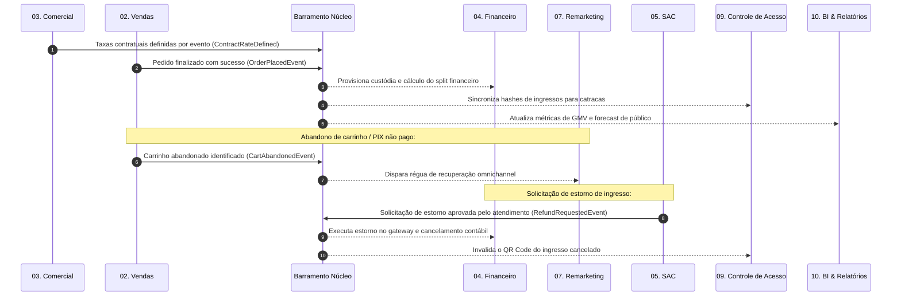

# 02 — Mapa de Módulos e Integrações (ERP DiskIngressos)

## 1. Visão Geral da Arquitetura

O **ERP DiskIngressos** é fundamentado no conceito de **ERP Modular com Autonomia Funcional**. 

A plataforma divide-se em um **Núcleo Central Unificado** e **10 Módulos Oficiais Autônomos**. Os departamentos chave — em especial **Comercial, Financeiro, Marketing, Remarketing e SAC** — operam sem dependência sequencial, sem travas operacionais e com responsabilidades de negócio bem demarcadas.

Documento de referência normativa: [`ARQUITETURA_MODULAR_DISKINGRESSOS.md`](file:///E:/DELTA_I/ARQUITETURA_MODULAR_DISKINGRESSOS.md).

---

## 2. NÚCLEO ERP DISKINGRESSOS (Serviços Centrais Compartilhados)

O Núcleo provê infraestrutura unificada para todos os módulos:

* **Identidade & Autenticação**: Login único, emissão de JWT HS256, MFA TOTP (RFC 6238) e gestão de sessões.
* **Usuários & Permissões**: Políticas centralizadas de RBAC (Role-Based) e ABAC (Attribute-Based), permitindo perfis específicos por módulo.
* **Cadastro Mestre de Produtores & Eventos**: Entidades centrais compartilhadas, eliminando qualquer duplicação cadastral.
* **Auditoria Imutável**: Log estruturado de todas as mutações e acessos com rastreabilidade forense (*before/after*).
* **Barramento de Eventos Internos (Transactional Outbox)**: Mecanismo de publicação de eventos assíncronos para integração desacoplada.

---

## 3. Catálogo Oficial dos 10 Módulos Autônomos

| Nº | Módulo | Foco de Negócio | Autonomia Funcional | Integração com o Núcleo |
| :-: | :--- | :--- | :--- | :--- |
| **01** | **Eventos e Cadastros** | Grade de shows, locais, arenas e produtores | Cadastra e homologa eventos sem dependência de comercial ou financeiro | Consome e atualiza entidades mestras de Produtores e Eventos |
| **02** | **Vendas e Ingressos** | E-commerce, checkout, pedidos e emissão de ingressos | Processa vendas e gera ingressos de forma contínua | Emite eventos de venda (`OrderPlacedEvent`) para o Outbox |
| **03** | **Comercial** | Negociação de taxas de conveniência, contratos e metas | Negocia e cadastra taxas por evento **sem depender do SAC ou Financeiro** | Registra contratos e emite `ContractRateDefined` |
| **04** | **Financeiro** | Gateways, conciliação bancária, custódia e repasses | Realiza conciliações e repasses **sem depender de atendimentos do SAC** | Processa liquidações e emite `SettlementClosed` |
| **05** | **SAC** | Central de tickets, atendimento ITIL v4, SLA e estornos | Trabalha chamados **sem interromper os demais módulos** | Dispara solicitações de estorno via evento assíncrono |
| **06** | **Marketing** | Campanhas de tráfego, UTMs, Pixels CAPI e ROAS | Cria campanhas e acompanha conversões **sem depender do Financeiro** | Associa tags UTM às vendas via eventos de conversão |
| **07** | **Remarketing** | Recuperação de carrinhos, WhatsApp/E-mail e públicos | Executa campanhas com **dados autorizados de vendas sem travar o checkout** | Reage a `CartAbandonedEvent` e pendências de pagamento |
| **08** | **PDV e Bilheterias** | Vendas presenciais em totens e bilheterias físicas | Vende ingressos com contingência local sem bloquear a web | Consolida fechamentos de caixa no módulo Financeiro |
| **09** | **Controle de Acesso** | Catracas, scanners de QR Code e gestão de lotação | Valida ingressos com cache local e alta disponibilidade | Consome hashes de ingressos e emite `AccessGrantedEvent` |
| **10** | **BI e Relatórios** | Indicadores C-Level, forecast e DRE gerencial | Camada analítica somente-leitura sem impacto transacional | Agrega métricas de todos os módulos de forma assíncrona |

---

## 4. Os 8 Pilares de Cada Módulo

Cada módulo no ERP DiskIngressos possui obrigatoriamente:
1. **Menu próprio**: Rota e hierarquia dedicadas.
2. **Dashboard próprio**: Indicadores específicos do setor em tempo real.
3. **Cadastros e configurações próprias**: Parâmetros sob gestão da área.
4. **Usuários e permissões específicas**: Perfis e alçadas delimitadas.
5. **Regras de negócio independentes**: Execução de lógica de domínio sem travas externas.
6. **Relatórios próprios**: Visões operacionais e financeiras segmentadas.
7. **Banco de dados integrado ao núcleo**: Modelos relacionados às chaves mestras sem duplicidade.
8. **Comunicação por APIs e eventos internos**: Contratos REST e barramento assíncrono.

---

## 5. Mapa de Integrações por Eventos de Domínio

