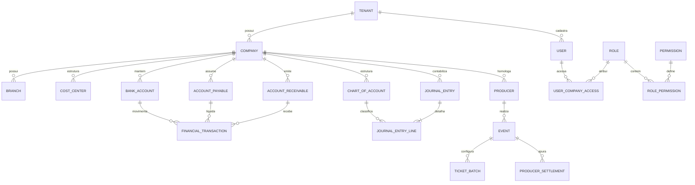

# 03 — Modelo de Dados PostgreSQL e Padrões de Integridade

## 1. Diretrizes Obrigatórias de Modelagem

1. **Chaves Primárias UUID v4**: Todos os registros utilizam `UUID` para impedir enumeração sequencial de recursos (`IDOR`).
2. **Isolamento Multi-Tenant e Multi-Empresa**:
   - Toda tabela de domínio possui `tenant_id` (`NOT NULL`) e, quando operacional, `company_id` (`NOT NULL`) e `branch_id` (opcional).
   - Índices compostos iniciam sempre por `(tenant_id, company_id, ...)`.
3. **Precisão Monetária Estrita**:
   - Proibido o uso de `FLOAT` ou `DOUBLE PRECISION` para valores financeiros.
   - Valores monetários utilizam `DECIMAL(18, 2)` e taxas/alíquotas utilizam `DECIMAL(10, 4)`.
4. **Idempotência Transacional**:
   - Operações financeiras, liquidações, repasses e lançamentos contábeis exigem `idempotency_key` única por `tenant_id`.
5. **Proibição de Deleção Física Contábil/Financeira**:
   - Títulos financeiros (`accounts_payable`, `accounts_receivable`), movimentações (`financial_transactions`) e lançamentos contábeis (`journal_entries`) são imutáveis após efetivação. Correções exigem lançamentos de estorno (`REVERSAL`).
6. **Partidas Dobradas no Banco de Dados**:
   - Todo `JournalEntry` (cabeçalho do lançamento contábil) contém linhas (`JournalEntryLine`) cuja soma de débitos deve ser exatamente igual à soma de créditos (`SUM(debit_amount) = SUM(credit_amount)`).

---

## 2. Diagrama Entidade-Relacionamento (Núcleo + Financeiro + Contábil + Eventos)

