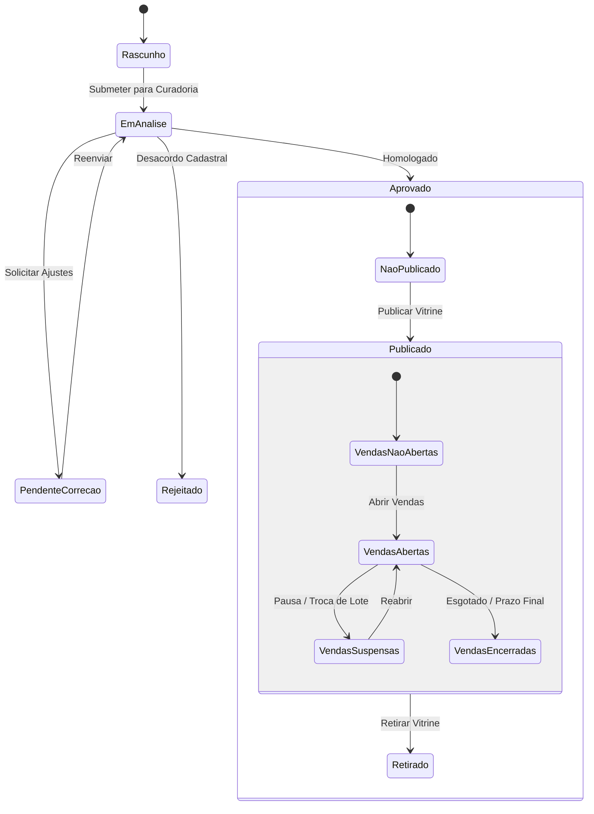

# 03 — Gestão de Eventos, Setores e Lotes (ERP DiskIngressos)

## 1. Princípio Arquitetural: As 4 Dimensões de Estado

No **ERP DiskIngressos**, o ciclo de vida de um evento não é reduzido a um único status linear. O evento é governado por **quatro dimensões ortogonais e independentes**:

| Dimensão | Estados Possíveis | Significado de Negócio |
| :--- | :--- | :--- |
| **Aprovação** (`approvalStatus`) | `DRAFT`, `UNDER_REVIEW`, `PENDING_CORRECTION`, `APPROVED`, `REJECTED` | Homologação cadastral, legal e técnica do evento pela curadoria/mesa de operações. |
| **Publicação** (`publicationStatus`) | `UNPUBLISHED`, `PUBLISHED`, `WITHDRAWN` | Visibilidade do evento na vitrine do site, aplicativo móvel e canais públicos. |
| **Vendas** (`salesStatus`) | `NOT_OPEN`, `OPEN`, `SUSPENDED`, `CLOSED` | Liberação do motor de checkout e bilheterias para processar pedidos de compra. |
| **Realização** (`realizationStatus`) | `SCHEDULED`, `COMPLETED`, `POSTPONED`, `CANCELLED` | Ocorrência física do espetáculo na arena ou local indicado. |

### Exemplo Prático de Independência:
* Um evento pode estar **Aprovado** (`APPROVED`), já **Publicado** na vitrine (`PUBLISHED`), porém com as **Vendas Ainda Fechadas** (`NOT_OPEN`), permitindo que os fãs visualizem a atração e se cadastrem em lista de espera antes do início do lote promocional.



---

## 2. Estrutura Hierárquica do Evento

```text
Evento (ex: "Curitiba Rock Fest 2026")
  └── Sessão / Data (ex: "14/11/2026 — Noite de Abertura")
        ├── Setor (ex: "Pista Premium", capacidade: 5.000)
        │     ├── Lote 1 (Qtd: 2.000, Face: R$ 200,00, Início: 01/09, Fim: 30/09)
        │     ├── Lote 2 (Qtd: 2.000, Face: R$ 250,00, Início: 01/10, Fim: 31/10)
        │     └── Lote 3 (Qtd: 1.000, Face: R$ 300,00, Início: 01/11, Fim: 14/11)
        └── Setor (ex: "Camarote Open Bar", capacidade: 1.200)
              ├── Lote Promocional (Qtd: 400, Face: R$ 450,00)
              └── Lote Regular (Qtd: 800, Face: R$ 550,00)
```

---

## 3. Regras de Inventário e Capacidade

1. **Capacidade Física Máxima Inegociável**:
   A soma das capacidades alocadas aos setores de uma sessão não pode ultrapassar a lotação oficial do alvará do local (`venueCapacity`).
2. **Virada de Lote Automática**:
   Um lote transita para o próximo por dois critérios configuráveis:
   * **Esgotamento**: Venda integral da cota de ingressos do lote vigente.
   * **Data/Hora**: Alcance do limite temporal fixado na programação do lote.
3. **Reserva Temporária de Inventário**:
   Durante o processo de checkout, os ingressos selecionados recebem status `RESERVED` por até 15 minutos. Se o pagamento não for confirmado pelo gateway, o inventário é liberado automaticamente de volta ao saldo disponível do lote.
