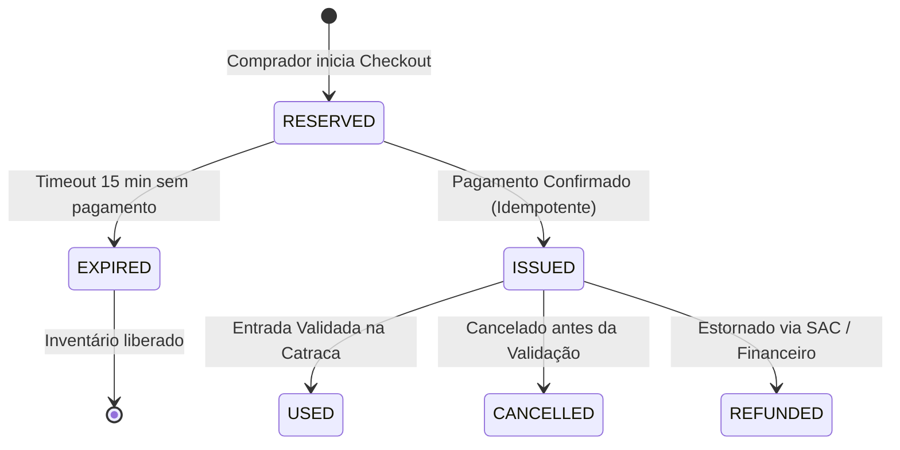

# 04 — Vendas, Checkout e Emissão de Ingressos (ERP DiskIngressos)

## 1. Padrão Oficial do Número do Ingresso

Em conformidade com a decisão da arquitetura oficial do DiskIngressos:

1. **Exatamente 8 Caracteres Numéricos**:
   * O número do ingresso é uma string numérica formatada com exatamente 8 dígitos, preenchida com zeros à esquerda:
     $$\text{ticketNumber} \in [00000001, 99999999]$$
   * Exemplo: `00045821`, `01258900`.
   * **Regra de Apresentação**: Em nenhuma tela, extrato, PDF de ingresso ou API o número pode perder seus zeros à esquerda (`padEnd`/`padStart(8, '0')` mandatório).

2. **Desacoplamento entre Identificador Visual e Credencial de Acesso**:
   * O **Número de 8 dígitos** é exclusivamente a identificação visual para o comprador, suporte do SAC e relatórios.
   * A **Validação na Catraca (Controle de Acesso)** utiliza uma **Credencial Criptográfica Segura Independente** (`accessValidationHash`):
     ```text
     accessValidationHash = HMAC_SHA256(secretKey, eventId + ":" + ticketNumber + ":" + buyerTaxId + ":" + issuedAt)
     ```
   * O QR Code escaneado na portaria transporta esse hash criptografado, impedindo que fraudadores falsifiquem ingressos tentando adivinhar números sequenciais.

3. **Escopo da Unicidade**:
   * O ERP adota **Unicidade do Número do Ingresso por Evento** com chave primária composta: `(eventId, ticketNumber)`.
   * Isso garante capacidade de até 100 milhões de ingressos por espetáculo sem risco de esgotamento do espaço numérico de 8 dígitos na história da empresa.

---

## 2. Ciclo de Vida do Ingresso



| Estado | Significado | Permite Acesso na Portaria? |
| :--- | :--- | :---: |
| `RESERVED` | Reserva temporária enquanto o comprador digita dados ou efetua o PIX | Não |
| `ISSUED` | Emitido com pagamento aprovado e entregue ao comprador | **Sim (uma única vez)** |
| `USED` | Já validado na catraca do evento com data e hora registradas | Não (Tentativa de Duplicidade) |
| `CANCELLED` | Cancelado administrativamente | Não |
| `REFUNDED` | Estornado; o QR Code é invalidado imediatamente | Não |

---

## 3. Garantia de Emissão Única (Idempotência)

* O webhook de confirmação de pagamento do gateway recebe um identificador único de transação (`gatewayPaymentId`).
* Se o gateway reenviar a notificação 2 ou mais vezes, o serviço de vendas verifica se o ingresso para aquele pedido já foi emitido:
  * Caso já emitido, retorna o registro existente sem reemitir, sem consumir estoque adicional e sem gerar cobrança duplicada.
